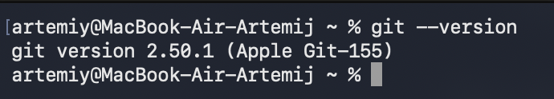
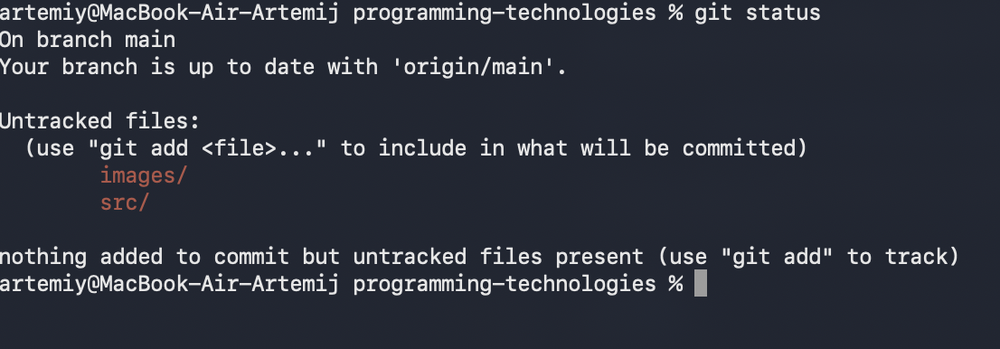
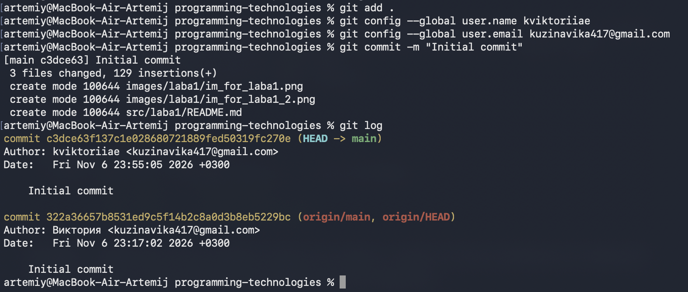
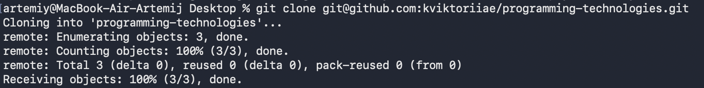
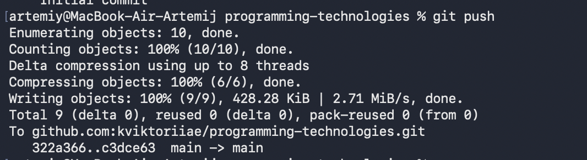

# Отчёт по лабораторной работе №1

**Основы работы с системой контроля версий Git** 


---

## 1. Цель работы

Изучить основные принципы работы с системой контроля версий Git, освоить создание локального репозитория, фиксацию изменений и взаимодействие с удалённым репозиторием GitHub.

## 2. Ход выполнения работы

### 2.1. Проверка установки Git

Выполнена проверка наличия Git в системе командой:

```bash
git --version
```

**Результат:** Git установлен и готов к использованию.

### 2.2. Создание локального репозитория

Создана директория проекта и выполнена инициализация Git-репозитория:

```bash
git init
```

Для проверки состояния файлов использована команда:

```bash
git status
```

**Результат:** создан локальный Git-репозиторий, файлы проекта обнаружены системой контроля версий.

### 2.3. Добавление файлов в индекс

Все файлы проекта добавлены в индекс командой:

```bash
git add .
```

После добавления выполнена проверка состояния репозитория:

```bash
git status
```

**Результат:** файлы проекта подготовлены к созданию коммита.

### 2.4. Настройка пользователя и создание коммита

Настроены имя и электронная почта пользователя:

```bash
git config --global user.name/user.email 
```

Создан первый коммит:

```bash
git commit -m "Initial commit"
```

Для просмотра истории коммитов использована команда:

```bash
git log
```

**Результат:** изменения проекта зафиксированы в первом коммите.

### 2.5. Создание удалённого репозитория

На платформе GitHub создан удалённый репозиторий.

Для подключения локального репозитория использована команда:

```bash
git clone "SSH-ключ"
```


**Результат:** удалённый репозиторий GitHub успешно добавлен.


### 2.6. Отправка изменений в удалённый репозиторий

Локальные коммиты отправлены на GitHub командой:

```bash
git push 
```


**Результат:** изменения успешно отправлены в удалённый репозиторий.
