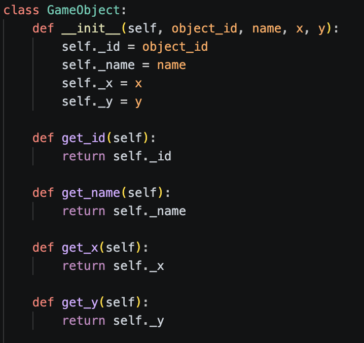
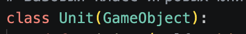
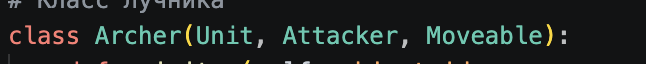
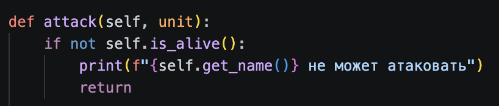
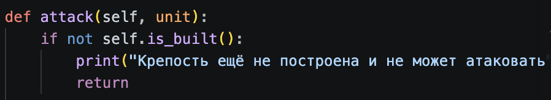
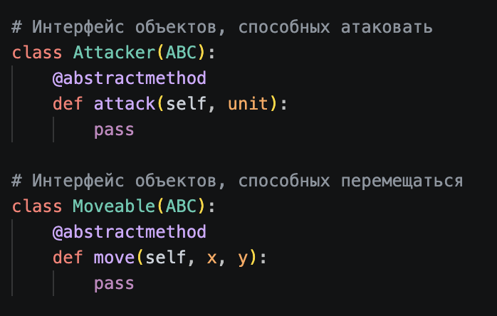
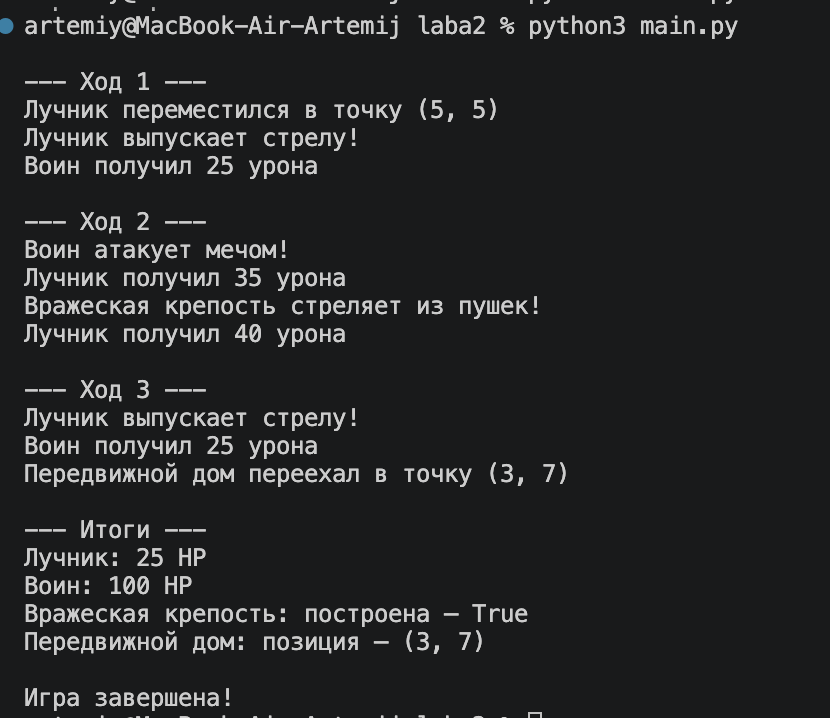

# Лабораторная работа №2 — Основы ООП

## Цель работы

Изучить принципы объектно-ориентированного программирования и реализовать иерархию классов для пошаговой стратегии.

## Описание

Реализована модель пошаговой стратегии с игровыми юнитами и постройками.

### Классы

- `GameObject` — базовый игровой объект.
- `Unit` — базовый класс юнитов.
- `Archer` — лучник.
- `Warrior` — воин.
- `Building` — базовый класс построек.
- `Fort` — атакующая крепость.
- `MobileHouse` — передвижной дом.

### Интерфейсы

- `Attacker` — определяет возможность атаки.
- `Moveable` — определяет возможность перемещения.

## Принципы ООП

- **Инкапсуляция:** характеристики объектов хранятся в атрибутах с `_`.



- **Наследование:** специализированные классы получают свойства базовых классов.

Например:



- **Полиморфизм:** разные игровые объекты реализуют атаку и перемещение по-своему.

Например, метод attack() есть у лучника, воина и крепости:



- **Абстракция:** интерфейсы определяют обязательные действия объектов.



## Запуск

```bash
python3 main.py
```

## Результат



Создана работающая модель игровых объектов с возможностью перемещения, атаки и получения урона.